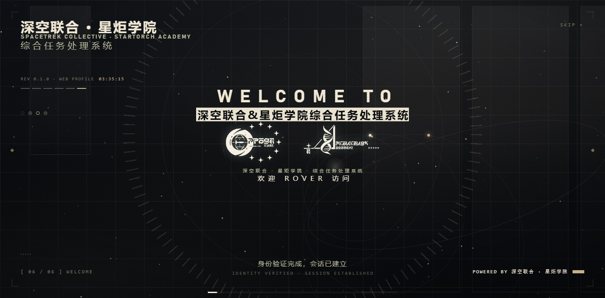
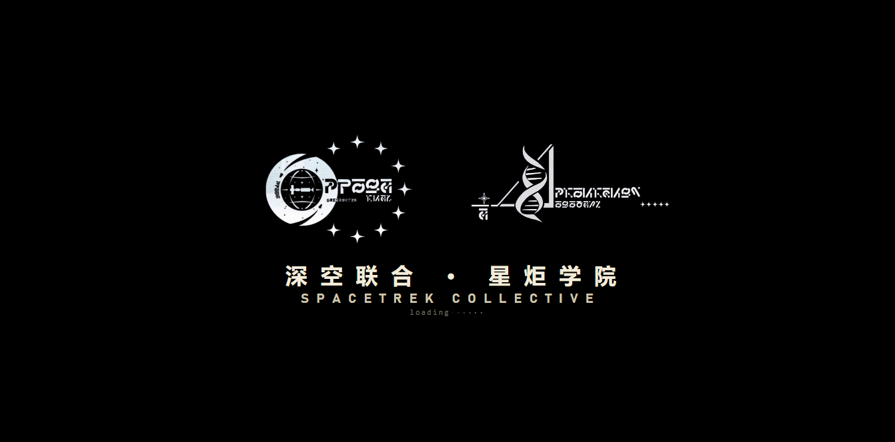
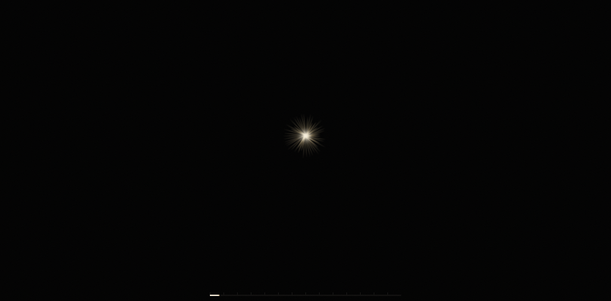
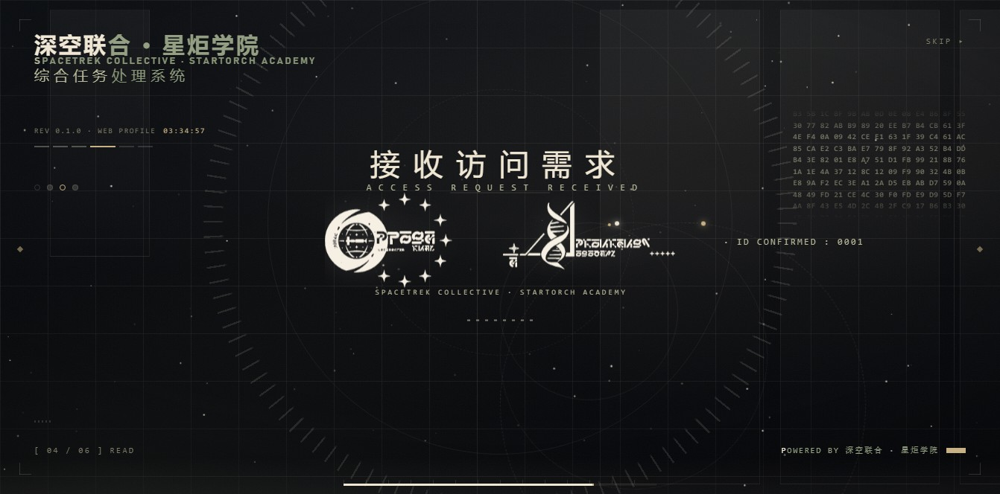
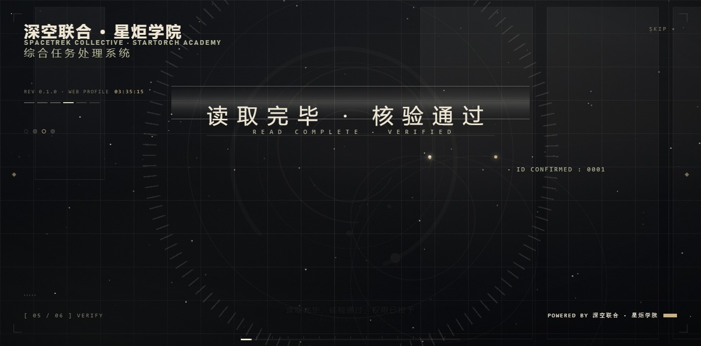
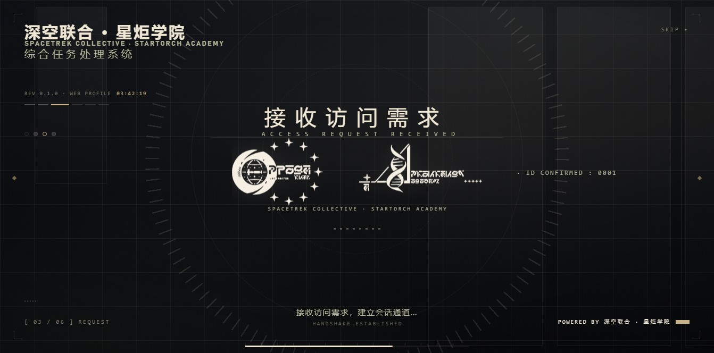
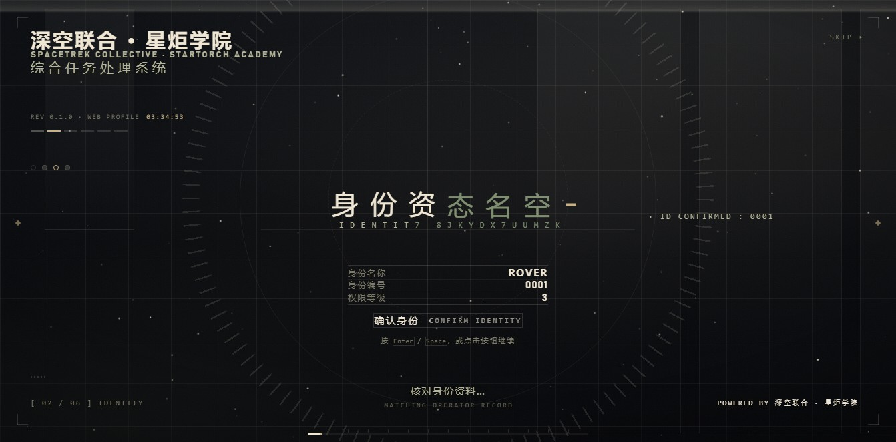
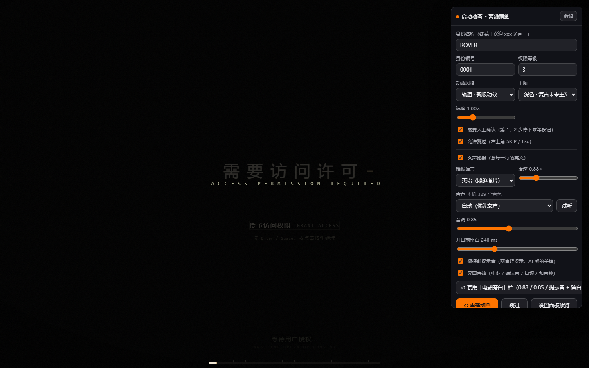

# dsh-orbit-boot

**DeepSeek Harness 的开屏动画插件。** 黑幕标识动效 → 光速拉丝转场 → 深色复古未来主义底板 → 六步授权序列 → 星野终幕。



<p>
  
  
  
  
</p>

---

## 特性

- **六幕完整开场**：黑幕标识动效 → 光速拉丝转场 → 深色底板 → 六步授权序列 → 星野终幕 → 揭幕。
- **两套动效风格**，设置页里一键切换，**刷新页面即生效**：
  - **轨道（默认）**：文字乱码收敛解码、横向故障带原地换词、光速拉丝转场、同心虚线轨道环、星野。
  - **经典**：逐字渐显、掠过标识的扫光、过曝洗白转场、结尾色散故障。
- **可交互，不是播片**：前两步要你点按钮或按 Enter 才继续（可关掉）；右上角 SKIP / Esc 随时跳过。
- **零运行时依赖**：不需要 `npm install`，不加载任何网络字体，素材全部走本地路由。
- **整套设置项**：动效风格、主题、速度、身份资料、语音与音效、配色、全部文案，都能在 DSH 设置页里改。
- 尊重系统的「减少动态效果」：晃眼的动效整段收掉，信息性的动效停转而不是消失。

---

## 动效设计

四条语汇贯穿全片，彼此复用：

| 语汇 | 做法 | 用在哪 |
|---|---|---|
| **文字乱码解码** | 每个字先以一串不相干的字形出现（中文取中文字池、拉丁取 A–Z0–9），再按左→右的节奏逐位收敛成正确字形；空格与标点不参与抖动 | 品牌块、黑幕机构名、六步主字与副标题、终幕三行 |
| **横向故障带** | 一条中间亮、上下透明的横带扫过；带子压住文字的那一刻，整句原地换掉 | 步骤切换（局部带）、第一幕收尾与第二幕入场（整屏带） |
| **光速拉丝 + 光晕绽放** | 46 条从中心朝各个方向甩出的细光条，加中心一朵炸开的暖光 | 过场、终幕揭幕 |
| **同心虚线轨道环** | 三层虚线 / 点线环各自反向自转，每层挂一个载点在环上跑 | 标志出现、校验阶段、终幕 |

另有一层常驻**星野**（150 颗随机细星，各带随机相位的闪烁），底板入场时点亮，终幕推到最亮。

### 轨道风格

| 第一幕 | 过场 |
|---|---|
|  |  |

| 步骤切换（故障带原地换词） | 校验阶段（同心轨道环） |
|---|---|
|  |  |

### 经典风格



两套风格的**文案、素材、版式、音效完全一样**，只有动效实现不同。

---

## 播放序列

| # | 中文主字 | 英文副标题 | 底部日志 | 需要操作 |
|---|---|---|---|---|
| 1 | 需要访问许可 | `ACCESS PERMISSION REQUIRED` | 等待用户授权… | 点按钮 / 按 Enter / 空格 |
| 2 | 身份资料确认 | `IDENTITY VERIFICATION` | 核对身份资料… | 点按钮 / 按 Enter / 空格 |
| 3 | 接收访问需求 | `ACCESS REQUEST RECEIVED` | 接收访问需求，建立会话通道… | 自动 |
| 4 | 开始读取权限 | `PERMISSION READ STARTED` | 开始读取权限，索引工作区与会话… | 自动 |
| 5 | 读取完毕 · 核验通过 | `READ COMPLETE · VERIFIED` | 读取完毕，核验通过，权限已授予 | 自动 |
| 6 | 欢迎「身份名称」访问 | `WELCOME TO` | 身份验证完成，会话已建立 | 自动 |

左上角阶段计数：`BOOT → AUTHORIZATION / IDENTITY / REQUEST / READ / VERIFY / WELCOME`。



---

## 安装

### 一、用 DSH 自己的插件命令（推荐）

```bash
dsh plugin --profile desktop add <本仓库路径或 npm 名>
```

装完**完全退出 DeepSeek Harness 再重新打开**。

### 二、用仓库里的本地脚本（Windows 上最省事）

```bash
node tools/install-desktop-local.mjs            # 默认装进 desktop profile
node tools/install-desktop-local.mjs --profile web
node tools/install-desktop-local.mjs --dry-run  # 只看会改哪些文件
```

它会：包体复制到 `~/.dsh/extensions/dsh-orbit-boot` 与
`<profile>/node_modules/dsh-orbit-boot`、在 profile 清单登记 `file:` 依赖、
把包名并进 `dsh.profile.bundles`。全程持 `<profile>/lock`，不和桌面端自己的
插件操作打架。

卸载：

```bash
node tools/uninstall-desktop-local.mjs
```

> ⚠️ 同一个 profile 里**只能有一个开屏插件生效**。两个都会往 index.html 注入
> 整屏开屏层，同时启用会叠在一起。安装脚本默认会把 `dsh-startup-screen`
> 从 `bundles` 里摘掉（包体与依赖保留，加回去即可恢复）。

### 三、先离线看一眼

双击 `打开预览.cmd`（Windows）或运行 `./open-preview.sh`，会打开
`preview/index.html` —— 一个不依赖 DSH 的完整预览页，右上角能调身份、主题、
动效风格、速度，第 1、2 步照样要你点按钮。



---

## 设置

装好后进入 **DSH 设置 →「开屏动画」**：

| 分组 | 可调 |
|---|---|
| 播放 | 启用、显示模式（每次会话 / 总是 / 每天）、速度（0.35 – 3×）、是否要求确认、是否允许跳过 |
| 身份 | 身份名称、身份编号、权限等级（显示在第二步的身份卡与终幕） |
| 交互 | 需要人工确认、允许跳过、音效 |
| 语音与音效 | 语音开关、来源、音色、语速、音调、音量、播报前提示音、开口前留白 |
| 视觉 | **动效风格**、主题（深色 / 暖白底板）、强调色、故障色 |
| 文案 | 品牌三行、黑幕两行、终幕方框、页脚 |

配置落盘在 `$DSH_HOME/dsh-orbit-boot.json`。

**改完不用重启 DSH。** 运行时会在每次开场前向 `/dsh-orbit/config`（`no-store`）
拉一次最新配置，覆盖 index.html 里那份页面加载时的快照；拉不到就退回快照继续播，
不会因为同步失败卡住开屏。

---

## 环境要求

| 项 | 要求 |
|---|---|
| 平台 | DSH **web** profile 或 **desktop** profile |
| Node | **>= 20** |
| 运行时依赖 | **零**（`dependencies` / `peerDependencies` 都是空的） |
| 字体 | 全部取系统自带（Bahnschrift / Cascadia Mono / 微软雅黑…），不下发 webfont |
| 音频 | 包内自带真声台词与界面音效；缺素材时自动回落到浏览器合成 |

---

## 仓库结构

```
lib/index.js          Host 半：路由（素材白名单 + Range）+ index.html 注入 + 配置读写
lib/splash.js         开屏运行时：时间线、动效层、语音与音效
lib/splash.css        全部样式（深色 / 暖白两套令牌 + 四条动效语汇 + 经典风格）
lib/client.js         设置面板（浏览器半）
lib/assets/           标识动效视频、静态标志板、真声台词、界面音效
preview/index.html    离线预览页（不依赖 DSH）
test/                 四套冒烟测试
tools/                本地安装 / 卸载脚本
docs/                 README 用的截图
cordis.patch.yml      bundle 层声明
```

跑测试：

```bash
node test/smoke-host.mjs
node test/smoke-splash.mjs
node test/smoke-client.mjs
node test/smoke-desktop-boot.mjs
# 或 npm test —— 共 275 项断言
```

改完怎么生效：

| 改了什么 | 怎么生效 |
|---|---|
| `lib/splash.js` / `lib/splash.css` / `lib/assets/*` | 刷新页面即可（按请求实时下发，按 mtime 缓存） |
| `lib/index.js`（宿主半侧） / `lib/client.js`（设置面板） | 完全退出桌面端再打开 |
| `test/*` | 直接跑，不需要装 |

---

## 素材与版权

这个项目**不是从零写的**，发布前请先读 [THIRD-PARTY.md](THIRD-PARTY.md)。要点：

- **代码**：宿主半侧的路由、注入、配置读写、语音通道、设置面板骨架沿用上游
  [dsh-startup-screen](https://github.com/6shenhonghong9/dsh-startup-screen)（MIT）；
  四条动效、样式表、两套主题是本仓库重写的。
- **音频**（`lib/assets/*.mp3`）：沿用上游，**上游注明取自第三方视频**。
  这是公开发布时最大的一处风险，请自行决定是否替换。
- **视频与图片**（`lib/assets/logo.mp4`、`logo-plate.png`）：由仓库所有者提供，
  本项目的许可**不覆盖**它们。

`LICENSE` 里保留了两行版权声明（上游一行 + 本项目一行），这是 MIT 的硬要求，
请不要删。

---

## License

[MIT](LICENSE) —— 覆盖本仓库作者原创的代码、文案与样式；不覆盖上游素材与
`lib/assets/` 下的第三方媒体，详见 [THIRD-PARTY.md](THIRD-PARTY.md)。
